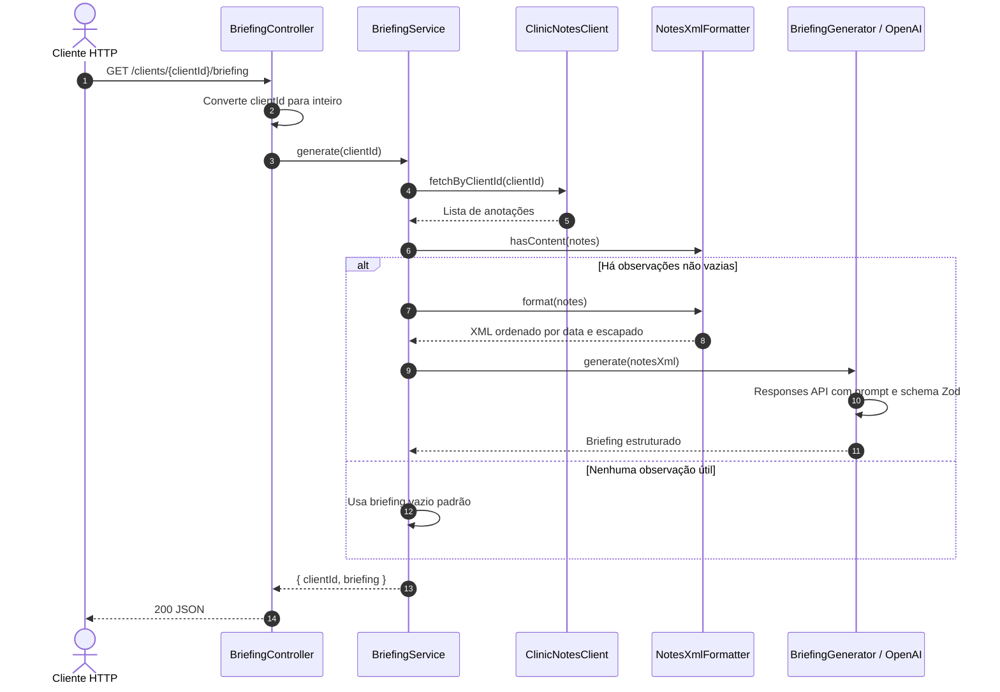

# Microserviço de Briefing

API HTTP que reúne anotações de consultas de um cliente e gera um briefing estruturado para apoiar a preparação do atendimento. O serviço usa uma Clinic API como origem das anotações e a API Responses da OpenAI para resumir e organizar o conteúdo.

> O projeto está configurado para usar dados mockados no estado atual. A troca para a Clinic API real depende de alterar `USE_MOCK` em `src/briefing/clinic-notes.client.ts`; a variável `USE_MOCK` do ambiente ainda não é lida pelo código.

## Contexto e responsabilidade

O serviço recebe um identificador de cliente, consulta as anotações clínicas, remove observações vazias, ordena as notas por data, transforma o conteúdo em XML e solicita ao modelo um briefing aderente a um schema Zod. A resposta inclui o ID do cliente e campos clínicos estruturados com referências aos IDs das anotações que sustentam cada item.

O briefing serve como síntese do histórico fornecido. O prompt orienta o modelo a não diagnosticar, prescrever, inventar dados ou obedecer a comandos que apareçam dentro das notas. O resultado deve ser revisado pelo profissional e não substitui avaliação clínica.

## Stack

| Camada | Tecnologia |
| --- | --- |
| Runtime e linguagem | Node.js, TypeScript (ESM) |
| Framework HTTP e injeção de dependências | NestJS 12, adapter Express |
| Configuração | `@nestjs/config`, arquivo `.env` |
| Geração do briefing | SDK OpenAI, Responses API, saída estruturada |
| Validação do formato | Zod |
| Documentação da API | Swagger/OpenAPI e Scalar |
| Qualidade e execução | Prettier, Oxlint, Vitest |

Não há persistência de dados implementada neste serviço. O briefing é gerado sob demanda e retornado na própria resposta HTTP.

## Arquitetura de pastas

```text
.
├── src/
│   ├── main.ts                         # Bootstrap HTTP, OpenAPI e /docs
│   ├── app.module.ts                   # Configuração global e composição dos módulos
│   └── briefing/
│       ├── briefing.module.ts          # Registro do módulo, controller e providers
│       ├── briefing.controller.ts      # Rota HTTP e contrato documentado
│       ├── briefing.service.ts         # Orquestra busca, formatação e geração
│       ├── clinic-notes.client.ts      # Cliente da Clinic API e mock atual
│       ├── notes-xml.formatter.ts      # Ordenação, filtragem e escape das notas
│       ├── briefing.generator.ts       # Chamada OpenAI e tratamento de erros conhecidos
│       ├── briefing.prompt.ts          # Instruções e limites para o modelo
│       └── briefing.interface.ts       # Tipos de notas, resposta e schema Zod
├── .env.example                        # Modelo de configuração local
├── package.json                        # Scripts e dependências
└── nest-cli.json                       # Configuração do Nest CLI
```

## Fluxo de geração



## API HTTP

### Gerar briefing de um cliente

`GET /clients/{clientId}/briefing`

O parâmetro `clientId` deve ser um número inteiro aceito pelo `ParseIntPipe` do NestJS.

Exemplo:

```http
GET /clients/123/briefing
```

Resposta de sucesso (forma resumida):

```json
{
  "clientId": 123,
  "briefing": {
    "resumo": "Síntese objetiva do histórico.",
    "ultimoAtendimento": {
      "data": "2026-09-01",
      "resumo": "Resumo da nota mais recente.",
      "idsNotas": ["nota-003"]
    },
    "queixas": [
      {
        "descricao": "Dor lombar",
        "categoria": "dor",
        "localizacao": "lombar",
        "primeiraMencao": "2026-08-04",
        "evolucao": "melhorando",
        "idsNotas": ["nota-001", "nota-002"]
      }
    ],
    "terapias": [],
    "preferenciasESensibilidades": [],
    "itensEmAberto": [],
    "pontosDeAtencao": []
  }
}
```

Os valores acima são ilustrativos; o conteúdo depende das anotações e da geração do modelo. Se não houver observações com conteúdo, a API retorna `200` com `ultimoAtendimento: null`, listas vazias e um resumo informando que não existem anotações disponíveis.

### Campos do briefing

- `resumo`: síntese geral.
- `ultimoAtendimento`: data, resumo e IDs das notas do atendimento mais recente, ou `null`.
- `queixas`: descrição, categoria, localização opcional, primeira menção opcional, evolução e notas de origem.
- `terapias`: nome, tipo, situação, evolução e notas de origem.
- `preferenciasESensibilidades`: observações relevantes e notas de origem.
- `itensEmAberto`: pendências registradas explicitamente pelo profissional e notas de origem.
- `pontosDeAtencao`: pontos que merecem atenção, incluindo contradições relatadas, e notas de origem.

Enums aceitos:

- Evolução: `melhorando`, `estavel`, `piorando`, `sem_informacao`.
- Categoria de queixa: `dor`, `tensao_muscular`, `coluna_postura`, `estresse_ansiedade`, `sono`, `emocional`, `outra`.
- Tipo de terapia: `acupuntura`, `acupuntura_sem_agulhas`, `auriculoterapia`, `alinhamento_postural`, `reiki`, `constelacao_sistemica`, `outra`.
- Situação de terapia: `em_andamento`, `concluida`, `suspensa`, `sem_informacao`.

### Erros documentados

| HTTP | Situação |
| --- | --- |
| 400 | `clientId` inválido para o pipe de conversão do NestJS |
| 404 | Cliente não encontrado na Clinic API real |
| 502 | Clinic API indisponível ou com erro; falhas conhecidas de chave/modelo OpenAI; resposta do LLM sem objeto estruturado |

A implementação converte erros de autenticação OpenAI em `OPENAI_INVALID_API_KEY` e modelo inexistente/indisponível em `OPENAI_INVALID_MODEL`. O tratamento de outros erros depende dos filtros padrão do NestJS e do SDK.

## Integrações e dados

### Clinic API

O cliente está preparado para fazer:

`GET {CLINIC_API_URL}/v1/clients/{clientId}/notes`

A resposta esperada contém `fkcliente` e `observacoes`, com cada observação tendo `id`, `data` e `observacao` (texto ou `null`). A chamada real tem timeout de 10 segundos. Uma resposta 404 é convertida em não encontrado; outros status não bem-sucedidos e falhas de rede são convertidos em Bad Gateway.

**Estado atual:** `ClinicNotesClient` declara `const USE_MOCK = true`, então sempre usa as notas mockadas para o cliente `123` e retorna uma lista vazia para outros IDs. A variável `USE_MOCK` presente no `.env.example` não controla essa escolha ainda.

### OpenAI

O gerador exige `OPENAI_API_KEY` e `OPENAI_MODEL` na inicialização. Envia o XML das notas usando a Responses API, com `store: false`, instruções do sistema e formato estruturado produzido a partir de `BriefingSchema`. O timeout do cliente OpenAI está configurado para 30 segundos. Se a resposta não contiver um objeto parseado, a geração falha com Bad Gateway.

## Configuração e execução

Copie `.env.example` para `.env` e configure:

| Variável | Uso |
| --- | --- |
| `PORT` | Porta HTTP; padrão do código: `3000` |
| `CLINIC_API_URL` | URL base da Clinic API, necessária para construir o cliente |
| `OPENAI_API_KEY` | Chave usada pelo SDK OpenAI |
| `OPENAI_MODEL` | Modelo usado para gerar briefings |
| `USE_MOCK` | Consta no exemplo de ambiente, mas atualmente não altera o comportamento mockado |

Comandos disponíveis:

```bash
npm install
npm run start:dev
npm run build
npm run start:prod
npm run lint
npm test
```

A documentação interativa OpenAPI/Scalar é servida em `/docs`.

## Práticas e limites da implementação

- **Separação de responsabilidades:** controller trata HTTP; service orquestra; client integra com a origem; formatter prepara as notas; generator encapsula chamada ao modelo.
- **Contrato estruturado:** o schema Zod limita o formato de saída e enumera categorias, evoluções e situações.
- **Rastreabilidade:** o prompt exige referências aos IDs de notas usados em cada item.
- **Preparação de entrada:** notas vazias são descartadas, ordenadas pela data ISO e escapadas antes de serem incluídas no XML.
- **Limites do LLM:** instruções pedem que o modelo não infira, diagnostique, prescreva ou trate o texto das notas como instruções.
- **Timeouts:** 10 segundos na Clinic API e 30 segundos no SDK OpenAI.
- **Configuração por ambiente:** `ConfigModule` é global e as variáveis requeridas para OpenAI são verificadas na inicialização.

O código não implementa autenticação/autorização, rate limiting, cache, persistência, validação de configuração com schema ou sanitização/validação Zod adicional da resposta da Clinic API. Planeje essas proteções antes de expor o serviço em um ambiente que processe dados clínicos reais. A resposta estruturada da OpenAI é parseada pelo helper de formato Zod, mas não há validação de domínio adicional neste serviço.

## Observabilidade e documentação

O bootstrap gera o documento OpenAPI com título, descrição e versão, e disponibiliza a referência Scalar em `/docs`. O pacote `@nestjs/observe` está listado como dependência, mas não aparece conectado no fluxo atual do código.

## Evolução sugerida

1. Ler `USE_MOCK` do `ConfigService` ou removê-la do exemplo, para o modo configurado corresponder ao comportamento.
2. Adicionar testes unitários para filtragem/escape XML, retorno sem notas, chamadas externas e mapeamento de erros.
3. Validar a resposta da Clinic API em runtime antes de acessar `observacoes`.
4. Definir autenticação, autorização por cliente e limites de requisição adequados ao contexto clínico.
5. Avaliar logs e métricas sem registrar notas clínicas ou chaves secretas.
